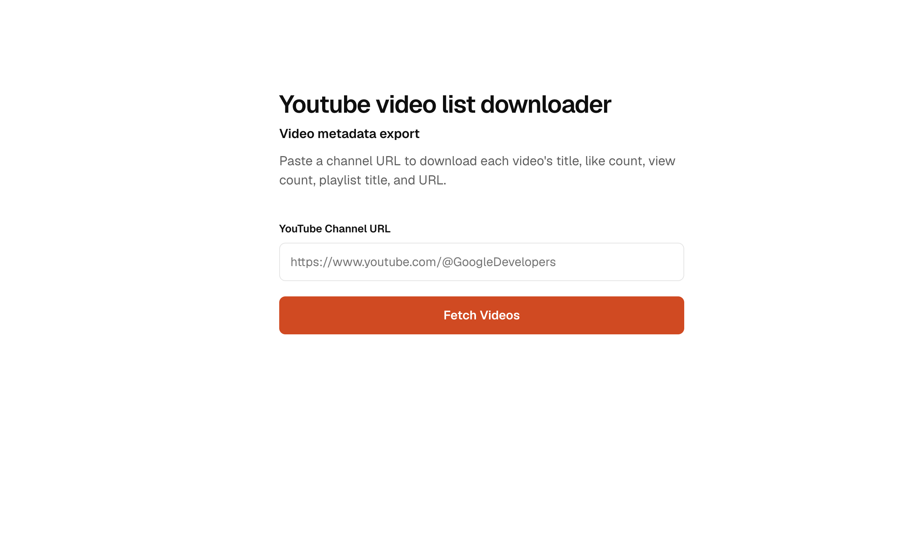
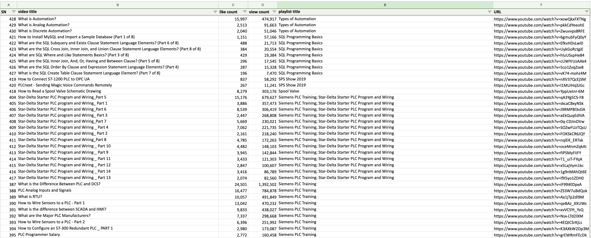

# YouTube Metadata Exporter

A simple YouTube metadata ingestion tool that extracts video metadata from a YouTube channel and exports it to an Excel spreadsheet. Simply paste a YouTube channel URL to retrieve the channel's videos and export the results.




## Prerequisites

- [Docker Desktop](https://www.docker.com/products/docker-desktop/) installed and running
- [YouTube API key](docs/youtube-api-key.md)

## Run

```sh
git clone https://github.com/bekcsys/youtubemetadata2excel.git
cd youtubemetadata2excel


make run # starts services 

make stop # stops services 
```

The first run asks for the API key and its Google account email. 
Open [http://localhost:3000](http://localhost:3000). 
